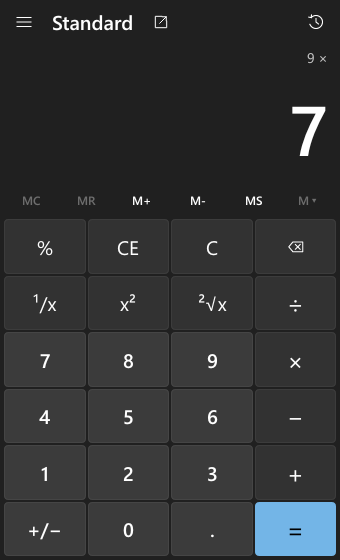
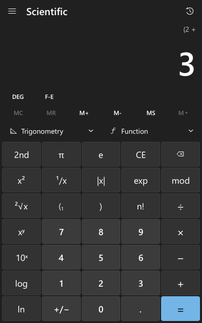
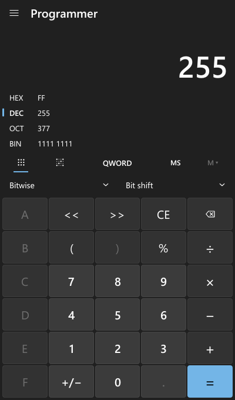
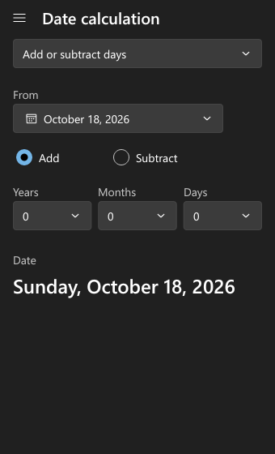
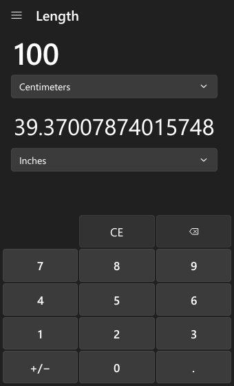
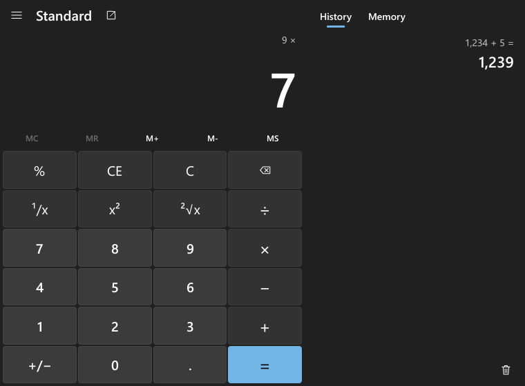

# rcalc

A portable desktop calculator written in Rust. Its layout and behaviour follow
[Windows Calculator](https://github.com/microsoft/calculator): the Fluent-style
keypad, the navigation pane, the history and memory panel, and its keyboard
shortcuts. The release build is a single ~1.7 MB `.exe`. It needs no
installation, no administrator rights, no network, and no runtime beyond
what ships with Windows.

| Standard | Scientific | Programmer | Date | Converter |
|---|---|---|---|---|
|  |  |  |  |  |

Wide windows dock the history and memory panel on the right:



> rcalc is an independent project and is not affiliated with Microsoft. The
> reference app was used only as a guide to behaviour and appearance (it is MIT
> licensed). No source code, logos, icons or other assets were copied: every icon
> is drawn from vector paths in `src/ui/icons.rs`, and the window icon is generated
> at runtime.

## Features

**Standard.** Immediate-execution arithmetic, like Windows: `2 + 3 ×` shows `5 ×`.
It also has `%`, `¹/x`, `x²`, `√x`, `±`, CE/C/backspace, and repeated `=`
(`5 + 3 = =` gives 11). Pressing two operators in a row replaces the first. A
"keep on top" compact mode is available.

**Scientific.** Full operator precedence and parentheses, with an open-paren
counter. It covers:

- `2nd` functions: x³, ∛x, ʸ√x, 2ˣ, logᵧx, eˣ.
- π, e, |x|, exp (scientific-notation entry), mod, n!, xʸ, 10ˣ, log, ln.
- Trigonometry flyout: sin, cos, tan, sec, csc, cot, each with inverse (2nd) and
  hyperbolic (hyp) variants.
- Function flyout: |x|, ⌊x⌋, ⌈x⌉, rand, →dms, →deg.
- DEG/RAD/GRAD and F-E (force scientific notation).

**Programmer.** HEX/DEC/OCT/BIN with live display of all four, and
QWORD/DWORD/WORD/BYTE word sizes. It has AND, OR, NOT, NAND, NOR, XOR, mod,
parentheses, and arithmetic, logical and rotate shifts. A bit-toggling keypad
covers all 64 bits. Digits invalid in the current radix are disabled, and
typing past the word size is refused.

**Date calculation.** Difference between two dates (years, months, weeks and
days, plus the total in days). Adding or subtracting years, months and days
clamps month ends: Jan 31 + 1 month is Feb 28/29. A calendar picker is
included.

**Converters.** Currency, Volume, Length, Weight and mass, Temperature, Energy,
Area, Speed, Time, Power, Data and Pressure, plus Angle. Factors use exact
definitions where one exists (an inch is exactly 0.0254 m, a pound exactly
0.45359237 kg). They are evaluated with the decimal engine, so
`1 in → 2.54 cm` is exact.

**History and memory.** History is shared by Standard and Scientific; clicking
an entry restores it. Memory works in all three calculator modes: MS, MR, M+,
M-, MC, plus per-item MC/M+/M- in the list. Both are saved between runs.

**Other.**
- Copy and paste (Ctrl+C/Ctrl+V). Pasted text is parsed as a full expression,
  e.g. `2(3+4)^2 - sin 30`. In Programmer mode it is read in the current radix.
- Light, dark and "use system setting" themes. The system accent color is
  picked up from Windows.
- DPI-aware rendering and fluid resizing. The minimum window size is 320×500.

## Building

Requires Rust 1.88 or newer.

### Windows with Visual Studio / Build Tools (MSVC) — recommended

```bash
cargo build --release
```

`.cargo/config.toml` links the C runtime statically (`+crt-static`), so the
exe does not need the VC++ redistributable.

### Windows with portable MSVC Build Tools (no Visual Studio install)

`dev.ps1` loads a portable Build Tools environment (`devcmd.ps1`) before running
cargo. By default it uses `D:\Portable\Tools\dev\msvc\devcmd.ps1`; set
`RCALC_MSVC_ENV` to use a different path.

```bash
powershell -ExecutionPolicy Bypass -File dev.ps1 build --release
```

### Windows with MinGW (GNU toolchain)

```bash
rustup toolchain install stable-x86_64-pc-windows-gnu
cargo +stable-x86_64-pc-windows-gnu build --release
```

The output then lands in the same `target\release` folder. Only the MSVC
build has been checked for dependencies; see "Portability" below.

### Output

```
target\release\rcalc.exe
```

### Tests

```bash
cargo test
```

The suite has 56 unit tests and 7 integration tests. They cover the decimal
engine, the parser and evaluator, all three keypad engines, programmer
overflow, dates, converters, the persistence round-trip, and the app's
keyboard and state handling. To render every view to `target/screens/*.png`
for visual review:

```bash
cargo test --lib screenshots -- --ignored
```

## Why this GUI stack

| Piece | Crate | Why |
|---|---|---|
| Window and input | `winit` 0.30 | Small, cross-platform, event-driven (`ControlFlow::Wait`: no polling) |
| Presenting pixels | `softbuffer` | Blits a CPU buffer with GDI on Windows: no GPU, OpenGL or DirectX dependency, so it works in VMs and over RDP |
| Shapes | `tiny-skia` | Anti-aliased rounded rectangles and paths, pure Rust |
| Text | `ab_glyph` | Lazily rasterised glyphs from the system's Segoe UI, cached per size |
| Accessibility | `accesskit` + `accesskit_winit` | Exposes every control to UI Automation (Narrator and other screen readers) |
| Numbers | `num-bigint` | Arbitrary-precision decimal arithmetic |

A full UI toolkit such as egui, iced or Slint would have saved some layout
code, but it brings a GPU renderer (wgpu/OpenGL), a larger binary and slower
startup. A Windows-Calculator look needs custom drawing anyway, so the UI is a
small immediate-mode layer (`src/ui`): each frame lays out the window from its
current size, paints it, and records widgets for hit-testing, keyboard focus and
the accessibility tree. Frames are drawn only in response to input.

Measured on the development machine with the release build: the window
appears about 0.3 s after process start. Private memory is about 11 MB, and
the app uses 0 ms CPU while idle.

## Portability

- **One file.** `rcalc.exe` statically links the Rust std and the C runtime.
  `dumpbin /dependents` lists only DLLs that ship with Windows:
  `user32`, `gdi32`, `kernel32`, `ntdll`, `advapi32`, `shell32`, `ole32`,
  `oleaut32`, `combase`, `uiautomationcore`, `dwmapi`, `uxtheme`, `imm32`,
  `bcryptprimitives` and an `api-ms-win-core` API set.
- **Fonts.** The UI uses the Segoe UI fonts in `%WINDIR%\Fonts`, which are part
  of Windows. They are read at runtime, not bundled, so the exe carries no font
  data. On other systems it falls back to DejaVu Sans or Arial.
- **No network.** Nothing in the program opens a network connection.
  Currency rates are bundled (see Known limitations).
- **Verified on:** Windows 10 Pro N 22H2 (build 19045), x64, which was the
  development machine. It has not yet been run on a freshly installed Windows
  VM or in Windows Sandbox. The dependency list above is why a clean system
  is expected to work, but that has not been tested.
- **Other platforms.** The calculation, parser, conversion and storage code is
  platform-independent and its tests are plain Rust. The UI layer uses
  winit/softbuffer, which support Linux and macOS, and the Windows-only parts
  are behind `cfg(windows)` (`src/platform.rs`). Non-Windows builds have not
  been compiled or tested; there, clipboard support is stubbed and the date is
  read in UTC.

## Saved data

Settings, history (up to 100 entries) and memory are stored as plain text in
`rcalc.ini`:

- **Portable mode.** If a file named `rcalc.portable` (or an existing
  `rcalc.ini`) is next to `rcalc.exe`, data is stored in that folder.
- Otherwise in `%APPDATA%\rcalc\rcalc.ini` (`$XDG_CONFIG_HOME/rcalc` on other
  systems).

Data is written atomically (temp file plus rename) when the window loses
focus or closes. If the folder cannot be written, the calculator keeps
working without saving, and the Settings page shows the reason. Corrupt or
unknown entries are ignored at load.

## Keyboard shortcuts

**All calculator modes**

| Key | Action |
|---|---|
| `0`–`9`, `.` or `,` | Digits and decimal point |
| `+` `-` `*` `/` | Operators |
| `Enter` or `=` | Equals |
| `Esc` | Clear (C); closes an open flyout first |
| `Delete` | Clear entry (CE) |
| `Backspace` | Delete last digit |
| `F9` | Negate (±) |
| `Ctrl+C` / `Ctrl+V` | Copy result / paste number or expression |
| `Ctrl+M` `Ctrl+P` `Ctrl+Q` `Ctrl+R` `Ctrl+L` | MS, M+, M-, MR, MC |
| `Ctrl+H` | History flyout (Standard/Scientific) |
| `Ctrl+Shift+D` | Clear history |
| `Alt+1` `Alt+2` `Alt+4` `Alt+5` | Standard, Scientific, Programmer, Date calculation |
| `Tab` / `Shift+Tab` | Move keyboard focus (focus ring appears) |
| `Space` | Activate the focused control |
| `Enter` on a focused non-keypad control | Activate it |
| Arrow keys | Move within flyouts and lists; change a focused drop-down |

**Standard and Scientific**

| Key | Action |
|---|---|
| `%` | Percent (Standard), mod (Scientific) |
| `r` | ¹/x |
| `q` | x² |
| `@` | √x |

**Scientific**

| Key | Action |
|---|---|
| `(` `)` | Parentheses |
| `^` or `y` | xʸ |
| `Ctrl+Y` | ʸ√x |
| `#` | x³ |
| `Ctrl+B` | ∛x |
| `!` | n! |
| `p` | π |
| `e` or `x` | exp (scientific-notation entry) |
| `s` `o` `t` | sin, cos, tan |
| `S` `O` `T` (Shift) | sin⁻¹, cos⁻¹, tan⁻¹ |
| `Ctrl+S` `Ctrl+O` `Ctrl+T` | sinh, cosh, tanh (add Shift for the inverses) |
| `l` / `n` | log / ln |
| `Ctrl+G` / `Ctrl+N` | 10ˣ / eˣ |
| `m` | mod |
| `v` | F-E |
| `F3` | Cycle DEG/RAD/GRAD |

**Programmer**

| Key | Action |
|---|---|
| `a`–`f` | Hex digits (in HEX) |
| `F5` `F6` `F7` `F8` | HEX, DEC, OCT, BIN |
| `F12` `F2` `F3` `F4` | Step the word size toward QWORD, DWORD, WORD, BYTE |
| `&` `\|` `^` `~` | AND, OR, XOR, NOT |
| `<` `>` | Shift left/right (rotate in rotate mode) |
| `%` | mod |

**Date picker**

Arrow keys move between days, `PageUp`/`PageDown` change the month, and
`Enter` or `Space` selects.

## Numeric precision

- Numbers are arbitrary-precision **decimals**
  (`coefficient × 10^exponent`, `src/num/dec.rs`), so decimal input is exact:
  `0.1 + 0.2 = 0.3`.
- Addition, subtraction and multiplication are exact up to 64 significant
  digits. Division and all functions are computed with extra guard digits and
  rounded half-to-even to 64 digits.
- The display shows 16 significant digits in Standard and 32 in Scientific,
  as Windows does. Small numbers stay in fixed notation while they fit.
  Larger ones switch to `1.5e+20`.
- When subtraction cancels below the working precision, the result snaps to
  zero, so `√2² − 2` gives `0`.
- Special angles are exact: sin 30° = 0.5, tan 45° = 1, and tan 90° gives
  "Invalid input".
- **Range:** magnitudes up to about 1e±9999. Beyond that the result is
  "Overflow"; it is never silently clamped. The largest factorial is 3248!.
- **Programmer mode** uses two's-complement integers of the selected word
  size. Like Windows, results wrap. Unlike Windows, every wrap that loses
  information shows an "Overflow: wrapped to QWORD" notice above the display.
  Division truncates toward zero, and `%` has the sign of the dividend (as in
  C).
- **Scientific `mod`** is floored: the result has the sign of the divisor, so
  `-7 mod 3 = 2`.
- **Percent:** `a + b%` means a plus b% of a; `a × b%` means a × b/100.
- **Unary minus** binds looser than `^`, so `-2^2 = -4`.

## Known limitations

- **No graphing mode.** Microsoft's graphing engine is proprietary and was not
  reimplemented.
- **Currency rates are not live.** The app ships an approximate snapshot of
  2025 reference rates, labelled as such in the UI. To use current rates, put
  a `currency.txt` next to `rcalc.ini` with lines such as `EUR = 0.92` (units
  per US dollar). A `# date: 2026-10-01` comment is shown as the rates' date.
  There is no automatic download, by design: the app never uses the network.
- **Converters** do not show Windows' "about equal to" comparisons (for
  example, "≈ 0.1 soccer fields").
- **Rotate through carry** is not implemented; arithmetic, logical and
  circular rotate shifts are.
- **Non-integer factorials** (gamma) are computed in double precision: about
  15 significant digits, for |x| < 170.
- **Trigonometric arguments** in radians are limited to |x| < 1e45. Larger
  values return "Invalid input".
- **Formatting** is fixed to en-US: `.` is the decimal point and `,` the
  thousands separator. The UI is English only.
- **Visuals.** There are no animations or Mica/acrylic translucency. Text is
  anti-aliased in grayscale, not ClearType.
- **Dead keys.** On layouts where `^` is a dead key (Portuguese, French and
  others), press it followed by Space, or use `y` for xʸ.
- **Accessibility** goes through AccessKit and UI Automation. Control names
  and invoking buttons were checked programmatically, but not with a full
  Narrator walkthrough.

## Project layout

```
src/
  num/        decimal type, math functions, numeric tests
  expr/       AST, tokenizer + Pratt parser, evaluator, parser tests
  calc/       keypad engine (Standard/Scientific/Programmer), programmer integers
  convert.rs  unit categories and currency
  date.rs     calendar arithmetic
  app.rs      application state, actions, keyboard shortcuts, persistence mapping
  storage.rs  settings file location and atomic save
  platform.rs Win32 clipboard, local date, theme and accent
  format.rs   digit grouping
  ui/         renderer (gfx), theme, icons, widgets, layouts (view), screenshot test
  main.rs     window, input, accessibility bridge
tests/        integration tests
```

## License

MIT. See [LICENSE](LICENSE).
