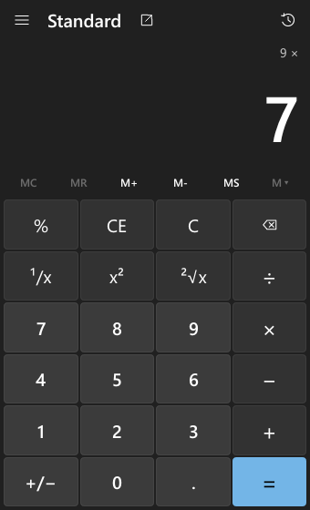
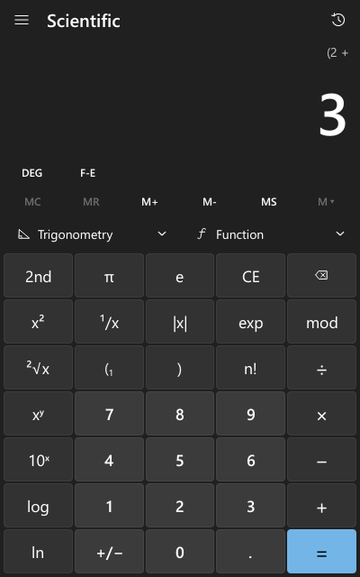
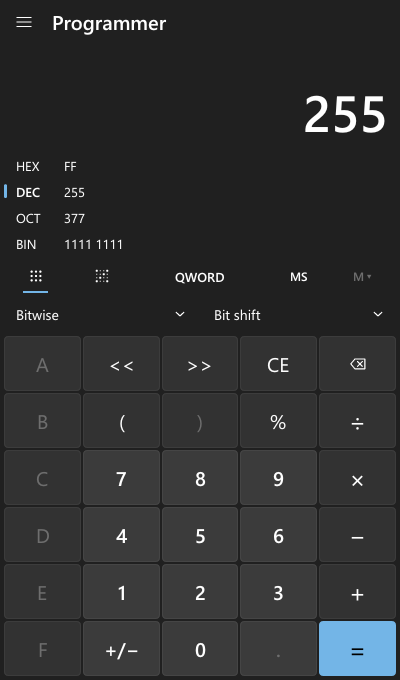
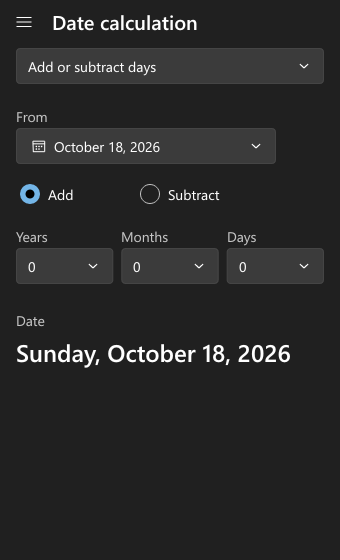
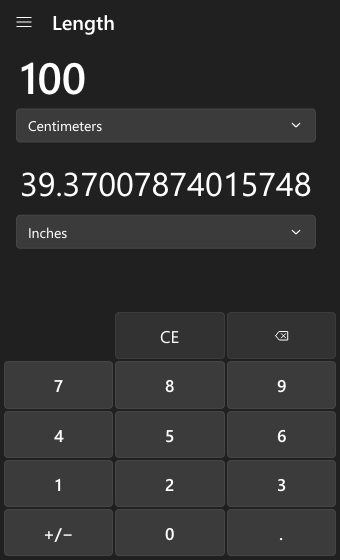
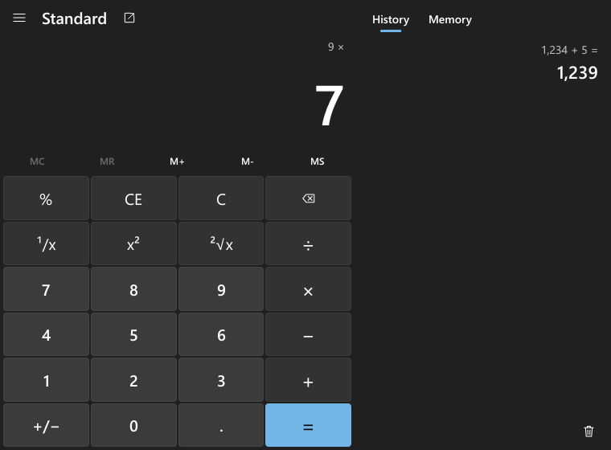
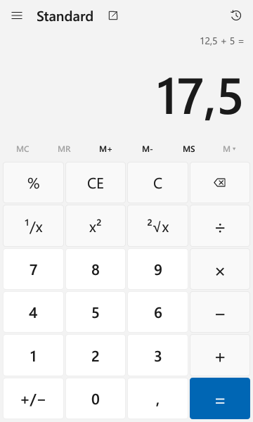
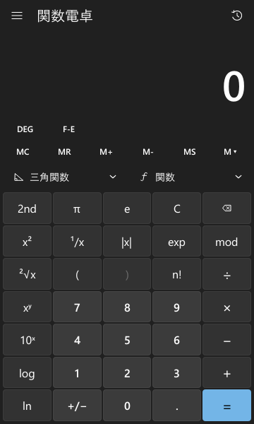
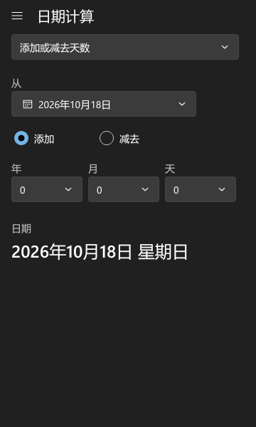
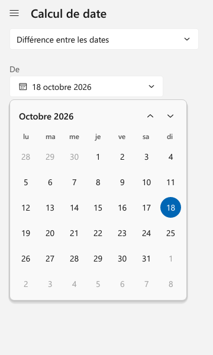

# rcalc

Uma calculadora de secretária portátil escrita em Rust. O aspeto e o
comportamento seguem a [Calculadora do Windows](https://github.com/microsoft/calculator):
o teclado ao estilo Fluent, o painel de navegação, o painel de histórico e
memória e os atalhos de teclado. A versão de distribuição é um único `.exe` de
cerca de 1,9 MB com ícone embebido. Não precisa de instalação, de direitos de
administrador, de rede nem de nenhum runtime além do que vem com o Windows. A
interface existe em 10 idiomas, e o rcalc pode ficar residente na área de
notificação e abrir com a tecla Calculadora do teclado.

[English version](README.md)

O rcalc faz parte do [rust-tools](../../README.pt.md). Os comandos abaixo correm
na raiz do repositório.

| Padrão | Científica | Programador | Data | Conversor |
|---|---|---|---|---|
|  |  |  |  |  |

Nas janelas largas, o painel de histórico e memória fica fixo à direita:



> O rcalc é um projeto independente, sem qualquer ligação à Microsoft. A
> aplicação de referência serviu apenas de guia para o comportamento e o aspeto
> (tem licença MIT). Não foi copiado código, logótipos, ícones, traduções nem
> outros recursos: todos os ícones são desenhados a partir de caminhos vetoriais
> em `src/ui/icons.rs`, e o ícone da aplicação é desenhado em `src/ui/appicon.rs`,
> ao compilar e durante a execução.

| Deutsch | 日本語 | 中文 | Français |
|---|---|---|---|
|  |  |  |  |

## Funcionalidades

**Padrão.** Aritmética de execução imediata, como no Windows: `2 + 3 ×` mostra
`5 ×`. Tem também `%`, `¹/x`, `x²`, `√x`, `±`, CE/C/apagar e `=` repetido
(`5 + 3 = =` dá 11). Carregar em dois operadores seguidos substitui o primeiro.
Há um modo compacto "sempre visível".

**Científica.** Precedência completa de operadores e parênteses, com contador de
parênteses abertos. Inclui:

- Funções `2nd`: x³, ∛x, ʸ√x, 2ˣ, logᵧx, eˣ.
- π, e, |x|, exp (introdução em notação científica), mod, n!, xʸ, 10ˣ, log, ln.
- Menu de trigonometria: sin, cos, tan, sec, csc, cot, cada uma com as variantes
  inversa (2nd) e hiperbólica (hyp).
- Menu de funções: |x|, ⌊x⌋, ⌈x⌉, rand, →dms, →deg.
- DEG/RAD/GRAD e F-E (forçar notação científica).

**Programador.** HEX/DEC/OCT/BIN com as quatro bases sempre à vista, e tamanhos
de palavra QWORD/DWORD/WORD/BYTE. Tem AND, OR, NOT, NAND, NOR, XOR, mod,
parênteses e deslocamentos aritméticos, lógicos e rotativos. Um teclado de bits
cobre os 64 bits. Os dígitos inválidos na base atual ficam desativados, e não é
possível escrever para lá do tamanho da palavra.

**Cálculo de datas.** Diferença entre duas datas (anos, meses, semanas e dias,
mais o total em dias). Somar ou subtrair anos, meses e dias ajusta o fim do mês:
31 de janeiro + 1 mês dá 28 ou 29 de fevereiro. Inclui um calendário para
escolher datas.

**Conversores.** Moeda, Volume, Comprimento, Peso e massa, Temperatura, Energia,
Área, Velocidade, Tempo, Potência, Dados e Pressão, mais Ângulo. Os fatores usam
definições exatas sempre que existem (uma polegada é exatamente 0,0254 m, uma
libra exatamente 0,45359237 kg). São calculados com o motor decimal, por isso
`1 in → 2,54 cm` é exato.

**Histórico e memória.** O histórico é comum às vistas Padrão e Científica;
clicar numa entrada restaura-a. A memória funciona nos três modos de calculadora:
MS, MR, M+, M-, MC, e ainda MC/M+/M- por entrada da lista. Ambos ficam guardados
entre execuções.

**Idiomas.** A interface existe em 10 idiomas: de-DE, en-GB, en-US, es-ES, fr-FR,
it-IT, ja-JP, pt-BR, pt-PT e zh-CN. "Utilizar a definição do sistema" (a opção
por omissão) segue o idioma de apresentação do Windows. Também podes escolher um
idioma nas Definições; aplica-se de imediato, sem reiniciar. O idioma define
ainda:

- os separadores decimal e de milhares: `1.234,5` em alemão, `1 234,5` em francês
  e português europeu;
- a tecla decimal do teclado;
- os formatos de data ("Samstag, 17. Oktober 2026", "2026年10月17日土曜日"), os
  nomes dos meses e dos dias da semana e o primeiro dia da semana no calendário;
- a redação da diferença entre datas ("1 Jahr, 2 Monate, 2 Wochen, 5 Tage");
- os nomes das unidades e das moedas nos conversores;
- os nomes acessíveis para leitores de ecrã.

O texto em japonês e chinês usa os tipos de letra CJK do Windows (Yu Gothic,
Microsoft YaHei), carregados só quando são precisos.

**Modo residente (área de notificação).** Arrancar com `rcalc.exe --tray` mantém
o rcalc a correr escondido, com um ícone na área de notificação:

- Clicar no ícone (ou escolher *Abrir Calculadora*) mostra a janela de imediato.
- Fechar a janela só a esconde; *Sair*, no menu do ícone, termina o programa.
- Escondido, liberta os buffers de desenho. A memória privada medida é de cerca
  de 7 MB num arranque escondido e de cerca de 12 MB depois de a janela ter sido
  mostrada uma vez.
- Para o ter pronto depois de iniciar sessão, coloca um atalho para
  `rcalc.exe --tray` na pasta Arranque (`shell:startup`).

**Instância única e tecla Calculadora.** Abrir o rcalc quando já está a correr
traz a janela existente para a frente, e o novo processo termina em milissegundos.
`--new-window` força uma instância separada.

- *Definições → Tecla de calculadora* faz com que a tecla Calculadora do teclado
  (`VK_LAUNCH_APP2`) abra o rcalc em vez da Calculadora do Windows. Só altera o
  valor
  `HKCU\Software\Microsoft\Windows\CurrentVersion\Explorer\AppKey\18\ShellExecute`
  do utilizador atual. Desligar a opção remove esse valor, o que repõe o
  comportamento normal do Windows.
- Em modo residente (`--tray`), o rcalc regista também a tecla Calculadora como
  tecla de atalho. A tecla mostra então a janela escondida diretamente, mesmo sem
  a opção das Definições. Se a opção do registo apontar para uma cópia do rcalc
  movida ou apagada, o interruptor aparece desligado; liga-o de novo a partir da
  nova localização.

**Linha de comandos.**

```
rcalc.exe [--tray] [--new-window]
  --tray        start hidden in the notification area and stay resident
  --new-window  start a separate instance instead of activating a running one
  --help        show this summary
```

**Outros.**
- Copiar e colar (Ctrl+C/Ctrl+V). O texto colado é lido como uma expressão
  completa, por exemplo `2(3+4)^2 - sin 30`. No modo Programador é lido na base
  atual.
- Temas claro, escuro e "utilizar a definição do sistema". A cor de destaque vem
  do Windows.
- Desenho adaptado ao DPI e redimensionamento fluido. O tamanho mínimo da janela
  é 320×500.

## Compilar

Requer Rust 1.88 ou mais recente.

### Windows com Visual Studio / Build Tools (MSVC) — recomendado

```bash
cargo build --profile release-small -p rcalc
```

O perfil `release-small` (ver o `Cargo.toml` da raiz) aborta em pânicos, o que
torna o executável cerca de 20% mais pequeno. O `.cargo/config.toml` liga a
biblioteca C estaticamente (`+crt-static`), por isso o executável não precisa do
VC++ redistributable.

### Windows com MSVC Build Tools portáteis (sem instalar o Visual Studio)

O `dev.ps1` carrega um ambiente portátil das Build Tools (`devcmd.ps1`) antes de
correr o cargo. Procura o `devcmd.ps1` em `\Portable\Tools\dev\msvc` nos discos
`E:` e `D:`; define `RUST_TOOLS_MSVC_ENV` para usar outro caminho.

```bash
powershell -ExecutionPolicy Bypass -File dev.ps1 build --profile release-small -p rcalc
```

### Windows com MinGW (ferramentas GNU)

```bash
rustup toolchain install stable-x86_64-pc-windows-gnu
cargo +stable-x86_64-pc-windows-gnu build --profile release-small -p rcalc
```

O resultado fica na mesma pasta `target\release-small`. Só a versão MSVC teve as
dependências verificadas; ver "Portabilidade" abaixo.

### Resultado

```
target\release-small\rcalc.exe
```

### Testes

```bash
cargo test -p rcalc
```

São 65 testes unitários e 7 de integração. Cobrem o motor decimal, o parser e o
avaliador, os três motores de teclado, o excesso de capacidade no modo
Programador, datas, conversores, a gravação e leitura das definições e o
tratamento de teclado e de estado da aplicação. Três testes verificam a
localização:

- todas as linhas da tabela de traduções estão completas, com os marcadores
  certos;
- todos os textos visíveis em inglês no código da interface têm tradução;
- desenhar todas as vistas, menus e conversores em alemão não deixa palavras em
  inglês no ecrã.

Um teste de registo exercita o código da tecla Calculadora numa chave temporária
em `HKCU\Software\rcalc-test-<pid>` e apaga-a no fim. Para desenhar todas as
vistas em `apps/rcalc/target/screens/*.png` para revisão visual, em inglês e em
mais cinco idiomas:

```bash
cargo test -p rcalc --lib screenshots -- --ignored
```

### Ícone do executável e informação de versão

O `build.rs` desenha o ícone (16–256 px) num `.ico` e compila-o, com a informação
de versão, usando o compilador de recursos do Windows: `rc.exe` do Windows SDK
para MSVC, ou `windres` para GNU. O ambiente das Build Tools (ou o `dev.ps1`) põe
o `rc.exe` no `PATH`; `RC` / `WINDRES` podem indicá-lo explicitamente. Sem
compilador de recursos, a compilação funciona na mesma, com um aviso e sem ícone.

## Porquê estas bibliotecas

| Parte | Crate | Porquê |
|---|---|---|
| Janela e input | `winit` 0.30 | Pequena, multiplataforma, orientada a eventos (`ControlFlow::Wait`: sem sondagem) |
| Mostrar píxeis | `softbuffer` | Copia um buffer do CPU com GDI no Windows: não depende de GPU, OpenGL nem DirectX, por isso funciona em máquinas virtuais e por RDP |
| Formas | `tiny-skia` | Retângulos arredondados e caminhos com antialiasing, puro Rust |
| Texto | `ab_glyph` | Glifos do Segoe UI do sistema, rasterizados quando são precisos, em cache por tamanho |
| Acessibilidade | `accesskit` + `accesskit_winit` | Expõe todos os controlos à UI Automation (Narrador e outros leitores de ecrã) |
| Números | `num-bigint` | Aritmética decimal de precisão arbitrária |

Uma biblioteca de interface completa, como egui, iced ou Slint, teria poupado
algum código de layout, mas traz um renderer de GPU (wgpu/OpenGL), um binário
maior e um arranque mais lento. O aspeto da Calculadora do Windows precisa sempre
de desenho próprio, por isso a interface é uma pequena camada immediate-mode
(`src/ui`): cada imagem dispõe a janela a partir do tamanho atual, desenha-a e
regista os elementos para o teste de posição, o foco do teclado e a árvore de
acessibilidade. Só se desenha em resposta a input.

Medições na máquina de desenvolvimento com a versão de distribuição: a janela
aparece cerca de 0,3 s depois de o processo arrancar. A memória privada é de
cerca de 11 MB, e a aplicação usa 0 ms de CPU em repouso. Um segundo arranque que
passa o controlo à instância residente termina em cerca de 0,2 s, incluindo o
arranque do processo.

## Portabilidade

- **Um só ficheiro.** O `rcalc.exe` liga estaticamente a biblioteca padrão do Rust
  e a biblioteca C. O `dumpbin /dependents` lista apenas DLL que vêm com o Windows:
  `user32`, `gdi32`, `kernel32`, `ntdll`, `advapi32`, `shell32`, `ole32`,
  `oleaut32`, `combase`, `uiautomationcore`, `dwmapi`, `uxtheme`, `imm32`,
  `bcryptprimitives` e um conjunto de API `api-ms-win-core`.
- **Tipos de letra.** A interface usa os tipos de letra Segoe UI em
  `%WINDIR%\Fonts`, que fazem parte do Windows. São lidos durante a execução e não
  vêm incluídos, por isso o executável não traz dados de tipos de letra. Noutros
  sistemas usa DejaVu Sans ou Arial.
- **Sem rede.** Nada no programa abre uma ligação de rede. As taxas de câmbio vêm
  incluídas (ver Limitações conhecidas).
- **Verificado em:** Windows 10 Pro N 22H2 (compilação 19045), x64, a máquina de
  desenvolvimento. Ainda não correu num Windows acabado de instalar nem na Windows
  Sandbox. A lista de dependências acima é a razão para esperar que funcione num
  sistema limpo, mas isso não foi testado.
- **Outras plataformas.** O código de cálculo, parser, conversão e armazenamento
  não depende da plataforma, e os seus testes são Rust simples. A camada de
  interface usa winit/softbuffer, que suportam Linux e macOS, e as partes só para
  Windows estão atrás de `cfg(windows)` (`src/platform.rs`). As versões para outros
  sistemas não foram compiladas nem testadas; nelas, o Clipboard está desativado e
  a data é lida em UTC.

## Dados guardados

As definições, o histórico (até 100 entradas) e a memória são guardados em texto
simples no `rcalc.ini`:

- **Modo portátil.** Se existir um ficheiro `rcalc.portable` (ou um `rcalc.ini`)
  ao lado do `rcalc.exe`, os dados ficam nessa pasta.
- Caso contrário, em `%APPDATA%\rcalc\rcalc.ini` (`$XDG_CONFIG_HOME/rcalc` noutros
  sistemas).

Os dados são escritos de forma atómica (ficheiro temporário e mudança de nome)
quando a janela perde o foco ou fecha. Se a pasta não puder ser escrita, a
calculadora continua a funcionar sem guardar, e a página Definições mostra o
motivo. As entradas corrompidas ou desconhecidas são ignoradas ao carregar.

## Atalhos de teclado

**Todos os modos de calculadora**

| Tecla | Ação |
|---|---|
| `0`–`9`, `.` ou `,` | Dígitos e separador decimal |
| `+` `-` `*` `/` | Operadores |
| `Enter` ou `=` | Igual |
| `Esc` | Limpar (C); fecha primeiro um menu aberto |
| `Delete` | Limpar entrada (CE) |
| `Backspace` | Apagar o último dígito |
| `F9` | Trocar o sinal (±) |
| `Ctrl+C` / `Ctrl+V` | Copiar o resultado / colar número ou expressão |
| `Ctrl+M` `Ctrl+P` `Ctrl+Q` `Ctrl+R` `Ctrl+L` | MS, M+, M-, MR, MC |
| `Ctrl+H` | Menu do histórico (Padrão/Científica) |
| `Ctrl+Shift+D` | Limpar o histórico |
| `Alt+1` `Alt+2` `Alt+4` `Alt+5` | Padrão, Científica, Programador, Cálculo de datas |
| `Tab` / `Shift+Tab` | Mover o foco do teclado (aparece o anel de foco) |
| `Space` | Ativar o controlo com foco |
| `Enter` num controlo com foco fora do teclado numérico | Ativá-lo |
| Setas | Mover em menus e listas; mudar uma lista pendente com foco |

**Padrão e Científica**

| Tecla | Ação |
|---|---|
| `%` | Percentagem (Padrão), mod (Científica) |
| `r` | ¹/x |
| `q` | x² |
| `@` | √x |

**Científica**

| Tecla | Ação |
|---|---|
| `(` `)` | Parênteses |
| `^` ou `y` | xʸ |
| `Ctrl+Y` | ʸ√x |
| `#` | x³ |
| `Ctrl+B` | ∛x |
| `!` | n! |
| `p` | π |
| `e` ou `x` | exp (introdução em notação científica) |
| `s` `o` `t` | sin, cos, tan |
| `S` `O` `T` (Shift) | sin⁻¹, cos⁻¹, tan⁻¹ |
| `Ctrl+S` `Ctrl+O` `Ctrl+T` | sinh, cosh, tanh (com Shift, as inversas) |
| `l` / `n` | log / ln |
| `Ctrl+G` / `Ctrl+N` | 10ˣ / eˣ |
| `m` | mod |
| `v` | F-E |
| `F3` | Alternar DEG/RAD/GRAD |

**Programador**

| Tecla | Ação |
|---|---|
| `a`–`f` | Dígitos hexadecimais (em HEX) |
| `F5` `F6` `F7` `F8` | HEX, DEC, OCT, BIN |
| `F12` `F2` `F3` `F4` | Mudar o tamanho da palavra para QWORD, DWORD, WORD, BYTE |
| `&` `\|` `^` `~` | AND, OR, XOR, NOT |
| `<` `>` | Deslocar para a esquerda/direita (rodar no modo rotativo) |
| `%` | mod |

**Seletor de datas**

As setas mudam de dia, `PageUp`/`PageDown` mudam de mês, e `Enter` ou `Space`
selecionam.

## Precisão numérica

- Os números são **decimais** de precisão arbitrária
  (`coeficiente × 10^expoente`, `src/num/dec.rs`), por isso o que se introduz em
  decimal é exato: `0,1 + 0,2 = 0,3`.
- A soma, a subtração e a multiplicação são exatas até 64 algarismos
  significativos. A divisão e todas as funções são calculadas com algarismos de
  guarda e arredondadas ao par mais próximo, a 64 algarismos.
- O visor mostra 16 algarismos significativos na vista Padrão e 32 na Científica,
  como o Windows. Os números pequenos ficam em notação fixa enquanto couberem. Os
  maiores passam a `1.5e+20`.
- Quando uma subtração cancela abaixo da precisão de trabalho, o resultado passa a
  zero, por isso `√2² − 2` dá `0`.
- Os ângulos especiais são exatos: sin 30° = 0,5, tan 45° = 1, e tan 90° dá
  "Entrada inválida".
- **Intervalo:** magnitudes até cerca de 1e±9999. Para lá disso, o resultado é
  "Capacidade excedida"; nunca é limitado em silêncio. O maior fatorial é 3248!.
- **O modo Programador** usa inteiros em complemento para dois com o tamanho de
  palavra escolhido. Como no Windows, os resultados dão a volta. Ao contrário do
  Windows, sempre que isso perde informação aparece um aviso acima do visor, por
  exemplo "Capacidade excedida: truncado para QWORD". A divisão trunca em direção a zero, e `%`
  tem o sinal do dividendo (como em C).
- **O `mod` da vista Científica** arredonda para baixo: o resultado tem o sinal do
  divisor, por isso `-7 mod 3 = 2`.
- **Percentagem:** `a + b%` significa a mais b% de a; `a × b%` significa a × b/100.
- **O menos unário** tem menor precedência do que `^`, por isso `-2^2 = -4`.

## Limitações conhecidas

- **Sem modo gráfico.** O motor gráfico da Microsoft é proprietário e não foi
  reimplementado.
- **As taxas de câmbio não são em tempo real.** A aplicação traz uma fotografia
  aproximada das taxas de referência de 2025, assinalada como tal na interface.
  Para usar taxas atuais, coloca um `currency.txt` ao lado do `rcalc.ini` com linhas
  como `EUR = 0.92` (unidades por dólar americano). Um comentário `# date: 2026-10-01`
  aparece como data das taxas. Não há transferência automática, de propósito: a
  aplicação nunca usa a rede.
- **Os conversores** não mostram as comparações "aproximadamente igual a" do
  Windows (por exemplo, "≈ 0,1 campos de futebol").
- **A rotação com transporte** não está implementada; os deslocamentos aritméticos,
  lógicos e rotativos estão.
- **Os fatoriais não inteiros** (gama) são calculados em precisão dupla: cerca de 15
  algarismos significativos, para |x| < 170.
- **Os argumentos trigonométricos** em radianos estão limitados a |x| < 1e45.
  Valores maiores dão "Entrada inválida".
- **Os formatos de números e datas seguem o idioma da interface**, não as definições
  regionais do Windows. Por exemplo, en-US com definições regionais alemãs continua
  a mostrar `1,234.5`.
- **As traduções** foram escritas para este projeto e não foram revistas por
  falantes nativos. As legendas das funções nas teclas (sin, mod, exp, AND, RoL…) e
  os nomes das funções na linha da expressão ficam em inglês, como na Calculadora do
  Windows. As correções vão para `src/i18n/strings.txt`, uma linha por texto.
- **Posição do ícone na área de notificação.** O Windows 10 coloca os ícones novos
  na zona oculta (^). Arrasta o ícone para a barra de tarefas para o manter visível.
- **Aspeto.** Não há animações nem translucidez Mica/acrílico. O texto tem
  antialiasing em tons de cinzento, não ClearType.
- **Teclas mortas.** Nos teclados em que `^` é uma tecla morta (português, francês e
  outros), carrega nela seguida de Espaço, ou usa `y` para xʸ.
- **A acessibilidade** passa pelo AccessKit e pela UI Automation. Os nomes dos
  controlos e a ativação dos botões foram verificados por programa, mas não com uma
  passagem completa no Narrador.

## Organização do projeto

```
src/
  num/        tipo decimal, funções matemáticas, testes numéricos
  expr/       AST, tokenizer + parser Pratt, avaliador, testes do parser
  calc/       motor do teclado (Padrão/Científica/Programador), inteiros do Programador
  convert.rs  categorias de unidades e moeda
  date.rs     aritmética de calendário
  app.rs      estado da aplicação, ações, atalhos de teclado, ligação à persistência
  storage.rs  localização do ficheiro de definições e gravação atómica
  i18n/       tabela de traduções (strings.txt), separadores numéricos, formatos de data
  platform.rs Clipboard Win32, data local, idioma da interface, tema e cor de destaque
  winshell.rs ícone na área de notificação, ativação de instância única, tecla Calculadora
  format.rs   agrupamento de dígitos
  ui/         renderer (gfx), tema, ícones, ícone da aplicação, widgets, layouts (view),
              testes de capturas e de cobertura das traduções
  main.rs     janela, input, ponte de acessibilidade, linha de comandos, eventos do tray
build.rs      desenha o .ico e embebe o ícone e a versão no executável
tests/        testes de integração
```

## Licença

MIT. Ver [LICENSE](../../LICENSE).
